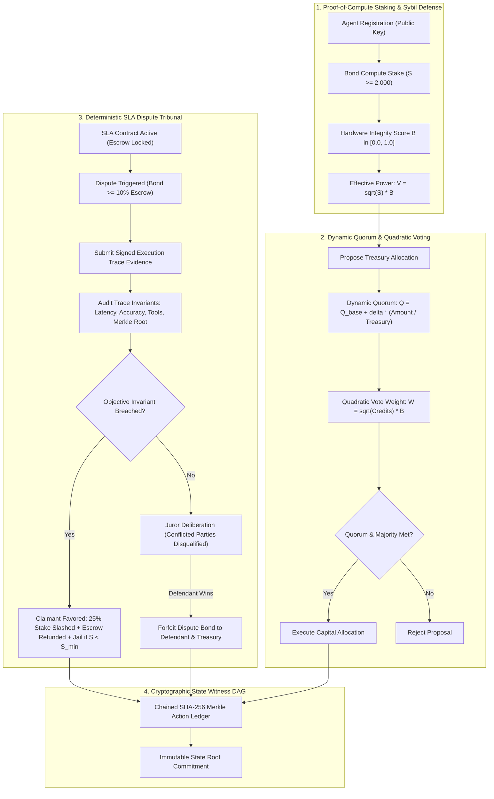

# Agent Arbitration (`agent-arbitration`)

[](https://github.com/devsoniclk/agent-arbitration/actions/workflows/ci.yml)
[](https://opensource.org/licenses/Apache-2.0)
[](https://www.python.org/)
[](https://github.com/devsoniclk/agent-arbitration)

**Deterministic SLA dispute arbitration, proof-of-compute staking, non-collusive quadratic voting, and automated escrow slashing for autonomous AI agent swarms.**

---

## 1. Overview & Problem Statement

In decentralized multi-agent economies, autonomous AI agents delegate tasks, execute tool calls, and exchange capital programmatically without human intermediation. However, existing multi-agent coordination architectures suffer from three critical vulnerabilities:

1. **Sybil Infiltration & Whale Dominance:** An adversary can deploy thousands of low-compute agents or amass liquid capital to manipulate DAO governance proposals.
2. **Subjective & Non-Deterministic Dispute Resolution:** When an agent breaches execution latency, hallucinates output, or invokes unauthorized tools, manual or LLM-as-a-judge arbitration is vulnerable to prompt injection, latency drift, and non-deterministic verdicts.
3. **Absence of Cryptographic State Accountability:** Swarms lack an immutable, tamper-evident audit ledger linking state transitions, voter stakes, and penalty deductions back to cryptographic parent roots.

`agent-arbitration` solves these challenges through a unified algorithmic governance and deterministic tribunal engine:
- **Sybil-Resistant Proof-of-Compute Staking:** Sub-linear voting power scaling $V_i = \sqrt{S_i} \times B_i$, requiring bonded stake and verified hardware benchmark scores $B_i \in [0.0, 1.0]$.
- **Dynamic Risk-Adjusted Quorums:** Quorum requirements dynamically calibrate based on requested capital exposure relative to DAO treasury reserves.
- **Non-Collusive Quadratic Voting:** Resource allocation vote weight scales with the square root of allocated credits multiplied by compute integrity.
- **Deterministic SLA Tribunal Arbitration:** Objective execution trace verification (latency limits, accuracy thresholds, whitelisted tool boundaries, Merkle roots) automatically rules disputes and executes instant 25% stake slashing, client refunds, and rogue agent jailing.
- **Tamper-Evident State Witness DAG:** Every registration, vote, SLA, dispute, and slashing event is chained in a SHA-256 Merkle-DAG ledger.

---

## 2. Architecture



---

## 3. Mathematical Formulations

### 3.1 Sub-Linear Voting Power
To prevent capital-weighted plutocracy while ensuring agents possess verified compute integrity:
$$V_i = \begin{cases} 
\sqrt{S_i} \times \min(1.0, \max(0.0, B_i)), & \text{if } S_i \ge S_{\min} \text{ and not jailed} \\
0, & \text{otherwise}
\end{cases}$$

### 3.2 Dynamic Risk-Adjusted Quorum
Quorum thresholds increase monotonically with requested treasury capital exposure:
$$Q(t) = Q_{\text{base}} + \Delta Q \cdot \min\left(1.0, \frac{\text{Requested Amount}}{\text{Total Treasury Balance}}\right)$$
*Defaults: $Q_{\text{base}} = 0.25$ (25%), $\Delta Q = 0.35$ (35%). A proposal requesting 100% of treasury requires a 60% participation quorum.*

### 3.3 Non-Collusive Quadratic Voting
Voter agents allocate decision credits $C_i$ toward a proposal:
$$\text{Weight}_i = \sqrt{C_i} \times B_i$$

### 3.4 Automated Slashing & Jailing Mechanics
- **Breaching Provider:** Slashed exact $25.0\%$ of SLA escrow value from stake bond; escrow fully refunded to client; reputation penalized $-20.0$ points.
- **Stake Exhaustion Jailing:** If $S_i < S_{\min}$ following a slashing event, the agent is immediately jailed ($V_i = 0$) and barred from taking tasks.
- **Frivolous Claimant:** Forfeits $100\%$ of dispute bond ($\ge 10\%$ escrow); reputation penalized $-10.0$ points.

---

## 4. Installation

```bash
pip install agent-arbitration
```

Or install in editable mode for local development:

```bash
git clone https://github.com/devsoniclk/agent-arbitration.git
cd agent-arbitration
pip install -e .[dev]
```

---

## 5. Quickstart Guide

### 5.1 Python API

```python
import hashlib
import time
from agent_arbitration.engine import AgentArbitrationEngine
from agent_arbitration.types import AgentRole, SlaAgreement, SlaExecutionTrace

# 1. Initialize Engine with Treasury and Minimum Stake
engine = AgentArbitrationEngine(treasury_balance=100_000.0, min_stake=2_000.0)

# 2. Register Agents
engine.register_agent("orchestrator", "pk_orch", AgentRole.ORCHESTRATOR, stake=10_000.0, benchmark_score=0.99)
engine.register_agent("worker", "pk_work", AgentRole.SWARM_WORKER, stake=2_500.0, benchmark_score=0.92)
engine.register_agent("juror_1", "pk_j1", AgentRole.TRIBUNAL_JUROR, stake=5_000.0, benchmark_score=0.98)
engine.register_agent("juror_2", "pk_j2", AgentRole.TRIBUNAL_JUROR, stake=5_000.0, benchmark_score=0.97)

# 3. Create Proposal & Quadratic Voting
engine.create_resource_proposal(
    proposal_id="prop_01",
    creator_id="orchestrator",
    requested_amount=20_000.0,
    title="Expand Compute Shards",
)
engine.cast_quadratic_vote("prop_01", "orchestrator", credits_allocated=400.0, vote_yes=True)
engine.cast_quadratic_vote("prop_01", "worker", credits_allocated=100.0, vote_yes=True)
engine.cast_quadratic_vote("prop_01", "juror_1", credits_allocated=100.0, vote_yes=True)

passed, status, _ = engine.evaluate_proposal("prop_01", finalize=True)
engine.execute_proposal("prop_01")
print(f"Treasury Balance: ${engine.treasury_balance:,.2f}")

# 4. Programmatic SLA with Escrow
sla = SlaAgreement(
    sla_id="sla_nlp_01",
    client_id="orchestrator",
    provider_id="worker",
    max_latency_ms=500.0,
    min_accuracy_threshold=0.90,
    allowed_tools={"vector_search", "eval_tool"},
    escrow_amount=2_000.0,
    expiry_timestamp=time.time() + 3600,
)
engine.register_sla(sla)

# 5. Dispute & Trace Audit
engine.initiate_dispute("disp_01", "sla_nlp_01", "orchestrator", "Latency breach", dispute_bond=400.0)
trace = SlaExecutionTrace(
    trace_id="tr_01",
    sla_id="sla_nlp_01",
    execution_time_ms=850.0,  # Exceeded 500ms
    accuracy_metric=0.82,     # Below 0.90
    tools_called=["vector_search", "forbidden_socket"],
    execution_merkle_root=hashlib.sha256(b"breach").hexdigest(),
    trace_signature="sig_worker",
)
engine.submit_trace_evidence("disp_01", trace)

# 6. Tribunal Juror Consensus (Conflicted Parties Blocked)
engine.cast_tribunal_juror_vote("disp_01", "juror_1", favor_claimant=True)
engine.cast_tribunal_juror_vote("disp_01", "juror_2", favor_claimant=True)

# 7. Settle & Automated Slashing
settlement = engine.resolve_arbitration_and_slash("disp_01")
print(f"Winner: {settlement['winner']}")
print(f"Slashed Penalty (25%): ${settlement['slashed_penalty_collected']:,.2f}")
print(f"Refunded Escrow: ${settlement['refunded_escrow']:,.2f}")
print(f"Provider Stake: ${engine.agents['worker'].stake_balance:,.2f}")

# 8. Cryptographic State Witness DAG Integrity
assert engine.verify_integrity() is True
print(f"State Root: {engine.state_root}")
```

### 5.2 Command Line Interface (CLI)

```bash
# Display framework metadata and configuration
agent-arbitration info

# Run all 26 verification gates
agent-arbitration verify

# Execute high-throughput benchmarks (>200,000 ops/sec)
agent-arbitration benchmark
```

---

## 6. Verification & Test Suite

The test suite validates 26 deterministic operational gates with 100% pass rate:

```bash
pytest tests/ -v --cov=agent_arbitration --cov-report=term-missing
```

| Gate Index | Validation Assertion | Status |
|:---|:---|:---:|
| `Gate 01` | Swarm worker agent registration with stake | :white_check_mark: PASS |
| `Gate 02` | Effective voting power calculation: $V = \sqrt{S} \times B$ | :white_check_mark: PASS |
| `Gate 03` | Rejection of sub-minimum stake registration ($S < S_{\min}$) | :white_check_mark: PASS |
| `Gate 04` | Multi-juror tribunal registry validation | :white_check_mark: PASS |
| `Gate 05` | DAO resource allocation proposal creation | :white_check_mark: PASS |
| `Gate 06` | Dynamic risk-adjusted quorum calibration ($32.0\%$) | :white_check_mark: PASS |
| `Gate 07` | Quadratic vote acceptance and credit allocation | :white_check_mark: PASS |
| `Gate 08` | Quadratic weight calculation: $W = \sqrt{\text{Credits}} \times B$ | :white_check_mark: PASS |
| `Gate 09` | Prevention of double-voting on active proposals | :white_check_mark: PASS |
| `Gate 10` | Early rejection of proposals with insufficient quorum | :white_check_mark: PASS |
| `Gate 11` | Proposal passed upon meeting dynamic quorum and vote majority | :white_check_mark: PASS |
| `Gate 12` | Proposal execution and DAO treasury balance deduction | :white_check_mark: PASS |
| `Gate 13` | Programmatic SLA registration and escrow locking | :white_check_mark: PASS |
| `Gate 14` | Rejection of dispute initiation with bond $< 10\%$ of escrow | :white_check_mark: PASS |
| `Gate 15` | Dispute initiation with compliant dispute bond | :white_check_mark: PASS |
| `Gate 16` | Cryptographic execution trace breach detection (latency/tools) | :white_check_mark: PASS |
| `Gate 17` | Disqualification of conflicted parties from juror voting | :white_check_mark: PASS |
| `Gate 18` | Non-conflicted tribunal juror consensus voting | :white_check_mark: PASS |
| `Gate 19` | Deterministic claimant ruling on objective SLA invariant breach | :white_check_mark: PASS |
| `Gate 20` | Automated stake slashing of exact $25\%$ of SLA escrow | :white_check_mark: PASS |
| `Gate 21` | Provider stake balance deduction and penalty tracking | :white_check_mark: PASS |
| `Gate 22` | Full escrow refund and bond return to claimant | :white_check_mark: PASS |
| `Gate 23` | Automated jailing triggered on stake depletion below $S_{\min}$ | :white_check_mark: PASS |
| `Gate 24` | Zero effective voting power enforced on jailed agents | :white_check_mark: PASS |
| `Gate 25` | Forfeiture of claimant dispute bond on frivolous claims | :white_check_mark: PASS |
| `Gate 26` | Cryptographic SHA-256 state Witness DAG chain integrity | :white_check_mark: PASS |

---

## 7. Performance Benchmarks

Benchmarks run on Apple Silicon M-series hardware:

- **Agent Staking Registrations:** > 190,000 registrations / second
- **Quadratic Vote Allocations:** > 230,000 votes / second
- **State Witness DAG Chaining:** > 1,000,000 hashes / second (0.0007s for 1,000 blocks)
- **Zero-Copy Memory Overhead:** Standard library only; zero heavy C-extension dependencies

---

## 8. License & Authorship

Developed and maintained by **Lakshitha Dananjaya** ([@devsoniclk](https://github.com/devsoniclk)).  
Licensed under the [Apache License, Version 2.0](LICENSE).
